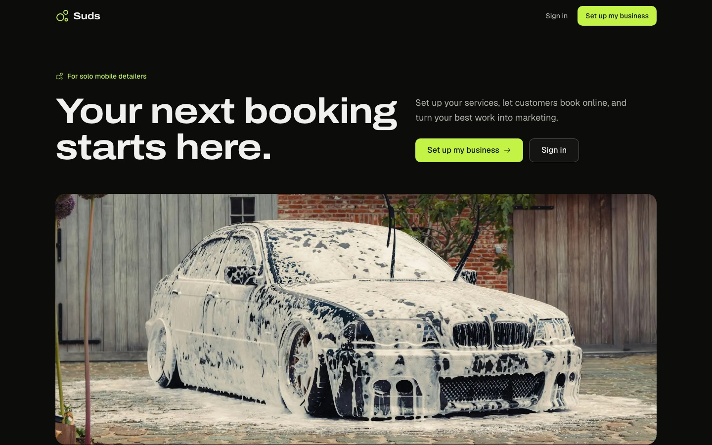

# Suds

**Wash. Work. Post.**

The back office for a one-person mobile detailing business. Bookings, jobs, invoices, and the marketing that comes after.

[suds.ahall.tech](https://suds.ahall.tech)



## what it does

- **book**: a public booking page per business; instant or owner-approved, with travel buffers and double-booking locks
- **portal**: customers manage appointments, vehicles and invoices on their own
- **work**: schedule, job progress, payments, printable invoices
- **post**: an AI assistant drafts posts from finished jobs and approved photos; photos become shorts (Shotstack), clips get edited (Submagic)
- **under the hood**: multi-business, staff invites, private R2 media, a background worker and an email outbox

Zero native deps: scrypt passwords, header-parsed images, a pure-JS PNG encoder.

## try it

```sh
npm run demo:prepare && npm run demo    # localhost:4184/demo
```

Fictional shop, guided tour, fake inbox. Needs a Postgres `DATABASE_URL`; the demo lives in its own schema.

## run

```sh
nvm use
npm ci
cp .env.example .env    # DATABASE_URL, DIRECT_URL
npm run db:generate
npm run db:deploy
npm run dev
```

`npm test` · `npm run typecheck` · `npm run lint:ci` · `npm run smoke`

## stack

Next.js 16 · React 19 · Prisma 7 / Postgres (Neon) · Tailwind 4 · Cloudflare R2 · Biome · Vitest · Vercel

## read next

- [CONTEXT.md](CONTEXT.md): domain and access rules
- [docs/architecture.md](docs/architecture.md): how it fits together
- [docs/product-plan.md](docs/product-plan.md): scope, and what's next
- [docs/launch.md](docs/launch.md): deploy runbook
