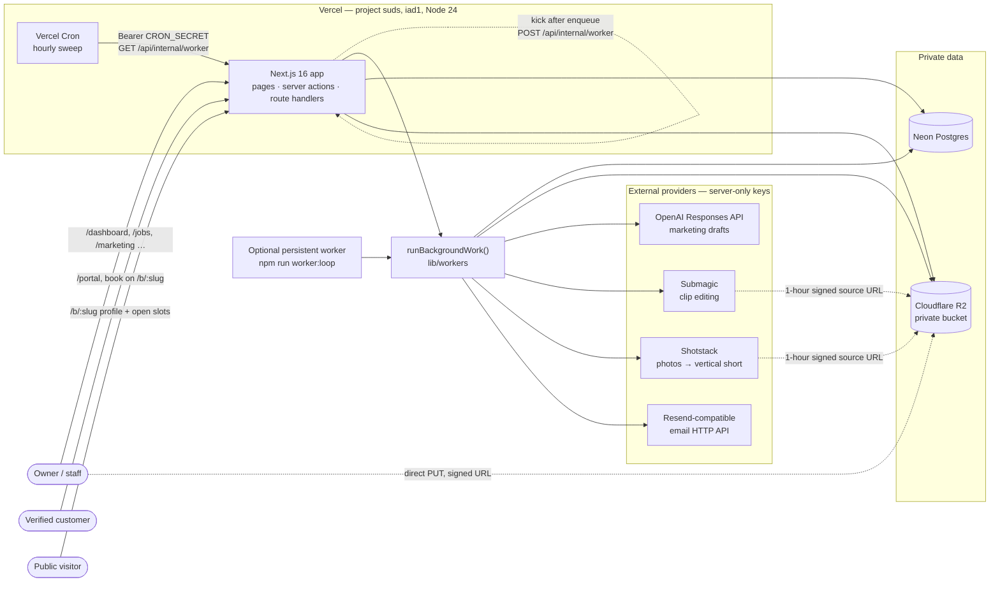
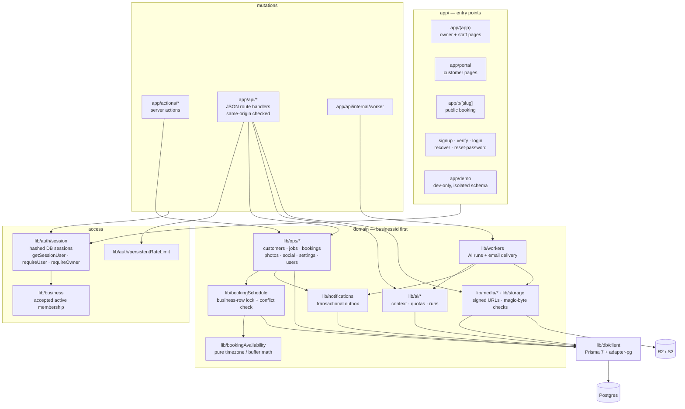
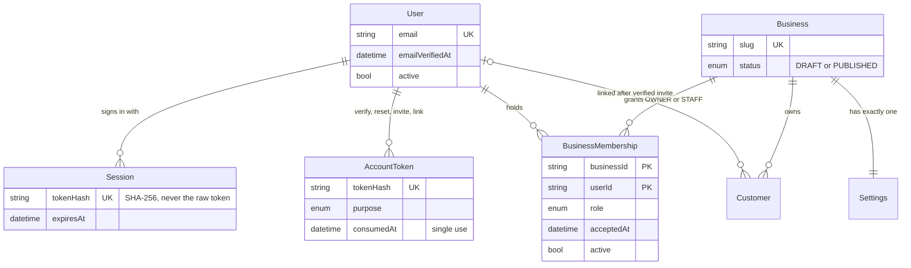
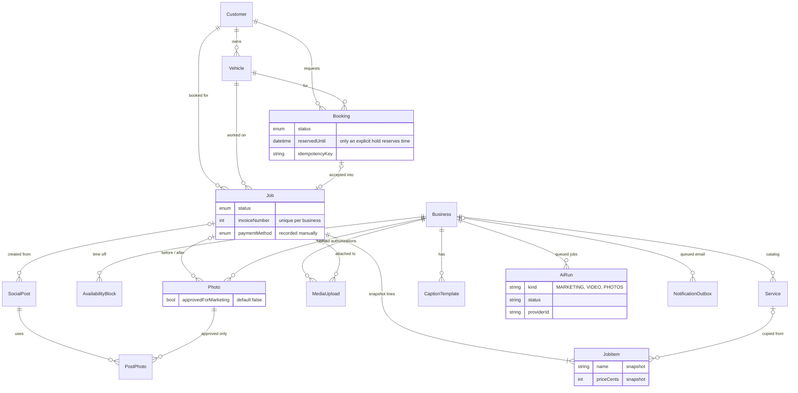
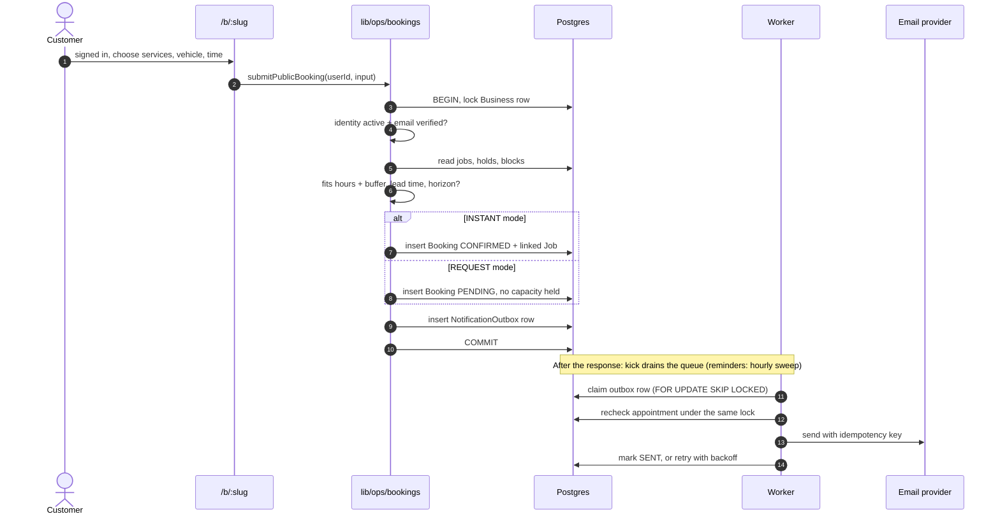
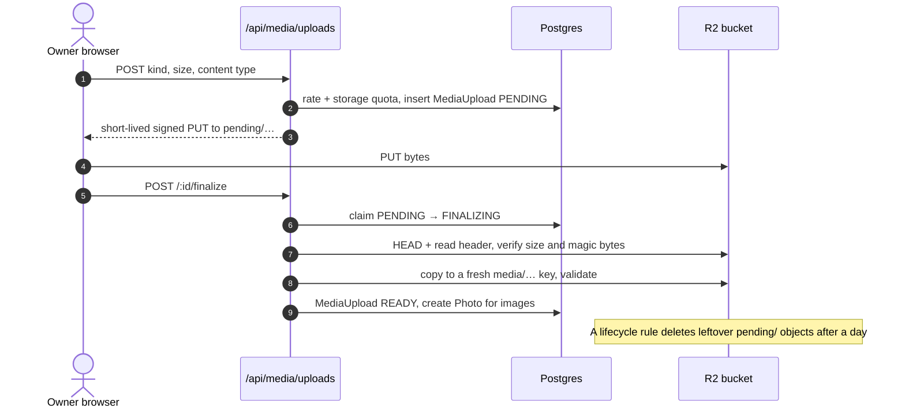
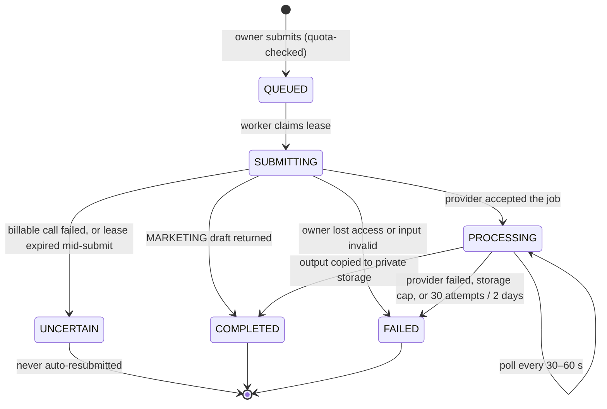

# Suds architecture

How the pieces fit: who uses the app, where it runs, how requests reach the
database, and how background work talks to paid providers. The rules behind these
diagrams live in [CONTEXT.md](../CONTEXT.md); module ownership is in
[AGENTS.md](../AGENTS.md); deployment steps are in [launch.md](launch.md).

## System context

One Next.js 16 app on Vercel serves three audiences. Postgres is the only system
of record. Requests only enqueue work; paid providers and email are called from
`runBackgroundWork()`, never while a page renders. Queueing work kicks the worker
route right after the response; an hourly cron sweep covers reminders and retries.
Both, and the optional long-running loop, share that code and can run together.

The app uses Neon's pooled `DATABASE_URL`. Migrations run separately with
`npm run db:deploy` over the unpooled `DIRECT_URL`; builds never migrate or seed. GitHub Actions runs every gate (tests, typecheck,
Biome, build, migrations, three smoke suites) against Postgres 17.

## Application layers

There is no `proxy.ts`. Every page, server action, and route handler
authenticates itself, and every domain operation takes `businessId` first.

## Data model

Every business-owned table carries `businessId`. Related rows join on composite
`(businessId, id)` foreign keys, so the database itself refuses a job that points
at another business's customer or vehicle.

### Identity and access

`RateLimitBucket` stands alone: database rate limits shared across instances.

### Operations, media, and marketing

## Booking: one lock for every calendar change

Owner job edits, booking acceptance, customer changes, and time-off blocks all
take the same business-row lock before reading busy time, so two writers can never
both see a free slot.

If the owner accepts a REQUEST booking, availability is checked again under the
lock and exactly one job is created. Cancel and reschedule release or replace the
time in the same transaction and cancel reminders that no longer apply.

## Direct media upload

Upload bytes go straight to the private bucket. The app grants permission for one
upload, then checks the result before creating any media record.

## Background work

`AiRun` and `NotificationOutbox` are durable Postgres queues. Each tick claims
rows with `FOR UPDATE SKIP LOCKED` and a lease, so kicks, the hourly sweep, and a
persistent worker can run at the same time without double-processing. A drain
ticks while work is due within its five-minute window (render status checks every
30 to 60 seconds, short retries) and then exits, leaving the database idle.

Before calling a provider, the worker confirms the requester is still an active
owner and rereads business facts and photo approval. Rendered video is downloaded
from an allowlisted provider host, capped at 50 MB, checked as MP4, and stored in
R2 before the run is marked complete. Each tick also deletes expired upload
authorizations. Queue failures appear on `/settings/operations`.
